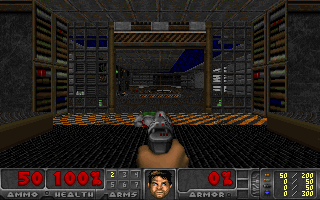
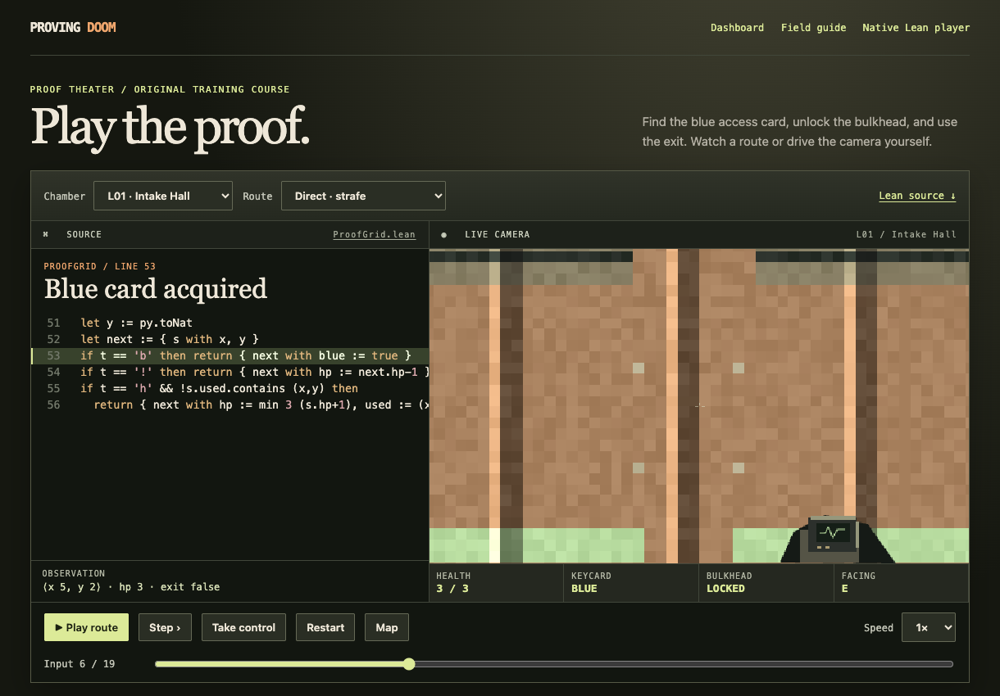
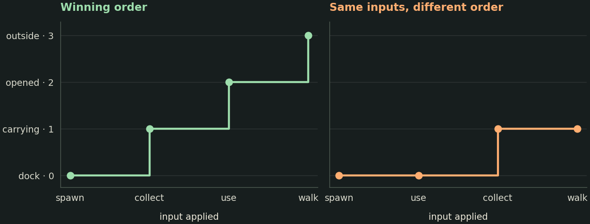

# What does it mean to prove a game level?

You watch a player cross the threshold, press Use and reach the exit. What would let someone else check that the same controls really win from the ordinary starting state? The answer depends on exactly which game program interprets the controls. This chapter follows the path from a WAD file through a Lean function to a theorem about *every prefix* of a particular run. The companion notebook lets you change a controller, break a proof and inspect the checker’s response. [Open the worked notebook](https://nasqret.github.io/leandoom-proofs/learn/notebook.html) · [Download the notebook](https://nasqret.github.io/leandoom-proofs/learn/passage-lab.ipynb)

## Three programs, three questions

**DOOM.** id Software’s game advances a simulation in discrete steps called *tics*. The map data, player input and current world determine what happens next. A WAD is a container of named byte ranges called *lumps*. Map lumps encode such things as vertices, linedefs (oriented edges), sectors (regions with floor and ceiling heights) and things (placed entities). Parsing and interpreting these records are separate operations. [Original lump loader](https://github.com/id-Software/DOOM/blob/master/linuxdoom-1.10/w_wad.c) · [Map structure definitions](https://github.com/id-Software/DOOM/blob/master/linuxdoom-1.10/doomdata.h) · [Original gameplay loop](https://github.com/id-Software/DOOM/blob/master/linuxdoom-1.10/p_tick.c)

**(Lean)DOOM.** Alaska Hoffman wrote a native Lean 4 game engine that reads original-format WADs. It contains gameplay routines, rendering, audio and proofs about selected mechanisms. Upstream’s arithmetic work compares fixed-point operations with an explicit model of x86 machine behavior. Its E1M1 correspondence project asks which observations of the original executable and the port agree as commands vary. A formal correspondence goal needs an initial-state relation, a step-preservation argument and a definition of what the observer can see. [Upstream project](https://github.com/alaskahoffman/leandoom) · [Arithmetic proof scope](https://github.com/alaskahoffman/leandoom/blob/dd795d67c075b3c3d1149494ddec6aff756e2a64/docs/ARITHMETIC_PROOFS.md) · [Upstream correspondence plan](https://github.com/alaskahoffman/leandoom/blob/943ccfedd26c73acebc75a61d4322ff8e5fa08df/docs/E1M1_CORRESPONDENCE_PLAN.md)

**Our research engine.** The passage proofs start from upstream revision `dd795d67c075b3c3d1149494ddec6aff756e2a64`. CombatV2 retains the walking, interaction and combat machinery and gives selected enemy computations specified integer arithmetic. Its weapon-state controller uses structural recursion with a decreasing fuel counter. Exhaustion is observable, so a successful error-free run also has to avoid it. These choices give Lean equations that the proof can reduce. The equivalence of CombatV2’s enemy arithmetic to upstream’s floating-point controller remains open. A theorem about an explicit CombatV2 run can already stand on its own. [Revision used for the port](https://github.com/alaskahoffman/leandoom/tree/dd795d67c075b3c3d1149494ddec6aff756e2a64) · [Recursive definitions in Lean](https://lean-lang.org/doc/reference/latest/Definitions/Recursive-Definitions/) · [Floating-point numbers](https://lean-lang.org/doc/reference/latest/Basic-Types/Floating-Point-Numbers/)

This frame shows what the native Lean worker can draw from redistributable game data. The historical Hangar theorem identifies a different map by its original bytes. [Open the native player](https://nasqret.github.io/leandoom-proofs/game/native.html) · [Freedoom project](https://freedoom.github.io/) · [Artwork terms](https://nasqret.github.io/leandoom-proofs/learn/freedoom-COPYING.txt)

The public site includes playable teaching courses with their own named semantics. Read the edition on a run before comparing it with a historical passage. The small four-phase airlock in this notebook is a separate example written for the lesson. You can read every transition in one screen. [Open the player](https://nasqret.github.io/leandoom-proofs/game/) · [Airlock’s complete Lean source](https://nasqret.github.io/leandoom-proofs/learn/PassageLab.lean)

## From bytes to a proposition

Let $B$ be the map-group bytes, $L$ the map label, $K=[k_1,\ldots,k_n]$ the recorded inputs and $T_e$ the tick function of engine edition $e$. Each $k_i$ encodes the buttons held on a single tick as a bit mask, allowing several simultaneous inputs. The level, difficulty, player initialization and random-generator state belong to the starting contract. In the research E1M1 case, the player begins at the ordinary medium single-player combat spawn. A checksum identifies the extracted bytes supplied to the parser. Proving what the parser returns on those bytes is a further logical step. [Pinned port source](https://github.com/alaskahoffman/leandoom/tree/dd795d67c075b3c3d1149494ddec6aff756e2a64/Doom) · [NIST’s Secure Hash Standard](https://csrc.nist.gov/pubs/fips/180-4/upd1/final)

$$
\operatorname{load}(B,L)=\operatorname{ok}(m),\qquad
\operatorname{spawn}(m)=\operatorname{ok}(s_0),\qquad
s_{i+1}=T_e(s_i,k_{i+1}).
$$

A *prefix* is an initial portion of a list. A safe first exit at input $n$ includes legality of the controls and the following three obligations. Here $\mathsf{safe}$ records positive health and the absence of a physics error. The first-exit condition rules out a movie that continues after a win and claims a later finish. [Nuclear Plant declarations](https://nasqret.github.io/leandoom-proofs/learn/records.html#e1m2) · [Quantifiers and equality in Lean](https://lean-lang.org/theorem_proving_in_lean4/quantifiers_and_equality.html)

$$
(\forall i\le n,\;\mathsf{safe}(s_i))\quad\land\quad
(\forall i<n,\;\neg\mathsf{exit}(s_i))\quad\land\quad
\mathsf{exit}(s_n).
$$

A *witness* is an object that satisfies an existential statement. Lean can use an already verified concrete tape $K$ and its passage theorem to construct a proof of $\exists K,\;\mathsf{Passage}(B,L,K)$. Searching for that tape and checking the submitted proof can be done by different programs. A human or an ML policy can propose the recording. The logical work is to connect those recorded commands to the game’s transitions. [Existential quantification](https://leanprover-community.github.io/mathematics_in_lean/C03_Logic.html) · [Proof-carrying computation](https://csd.cs.cmu.edu/academics/doctoral/degrees-conferred/george-ciprian-necula)

## Why the middle of a passage is hard

### A moving player changes several data structures

Consider the first movement attempt on the recorded Computer Station route. The collision query encounters a clip. Ammunition rises from 50 to 60 and the clip’s slot is removed. The player has to leave the old spatial lists and enter the lists for sector 60 and blockmap cell 846. The *blockmap* indexes objects by a spatial grid so that collision queries can limit the area they search. A correct move must preserve the structures on which the *next* query relies. The theorem returns the complete updated collision scene and an empty list of special lines crossed. The rest of this tick, including subsequent updates, is a separate obligation. [Checked movement declaration and audit](https://nasqret.github.io/leandoom-proofs/learn/records.html#e1m7) · [Original movement code](https://github.com/id-Software/DOOM/blob/master/linuxdoom-1.10/p_map.c)

### Two identical pictures can have different futures

A screenshot is a projection $\pi(s)$ of the full state. Position, sprite and health may match while a random-generator index, a door timer or a delayed projectile differs. Therefore $\pi(s)=\pi(t)$ does not in general give $T_e(s,k)=T_e(t,k)$. The Nuclear Plant witness records a total of 1,017 inputs. Its suffix proof after input 19 accounts for 998 more ticks and 65 ordered actor slots per tick. That is 64,870 slot updates before counting the movement, weapon, projectile and world stages. Changing the state used at a chunk boundary can invalidate the remaining certificate. [Nuclear Plant record](https://nasqret.github.io/leandoom-proofs/learn/records.html#e1m2) · [Original random-number generator](https://github.com/id-Software/DOOM/blob/master/linuxdoom-1.10/m_random.c) · [Behavior-preserving simulations in CompCert](https://compcert.org/man/manual001.html)

### A runnable function may resist reduction in a proof

Lean elaborates a command into a term. A small *kernel* checks that the term has the claimed type. A *tactic* such as `decide` helps produce a term. A compiled program can execute operations that lack the equations one wants for reduction inside the logic. The upstream weapon controller includes a partial recursive routine. With default weapon state, progressing even without firing can enter that routine. Structural recursion on fuel gives the revised controller a defined result in every case. Opaque conversions and trigonometric calls in enemy code motivated the arithmetic revision. The equation $T_e(s,k)=t$ names the edition, so a successful check cannot silently transfer to another version. [Axioms and computation](https://lean-lang.org/theorem_proving_in_lean4/axioms_and_computation.html) · [Kernel validation](https://lean-lang.org/doc/reference/latest/ValidatingProofs/) · [Recursive definitions](https://lean-lang.org/doc/reference/latest/Definitions/Recursive-Definitions/)

### What exactly does the endpoint establish?

On Command Control the two approaches to the blue-card door have walk-over special 90. The actual crossing callback leaves the map unchanged for every world with a type 90 or 86 line. A controller that expects the door to open there depends on an event that the named edition never supplies. [Map-bound crossing theorem and fresh audit](https://nasqret.github.io/leandoom-proofs/evidence/e1m4/result.json)

On Phobos Anomaly the ordinary starting state offers 333 possible linedef targets to the Use dispatcher. For each choice, the resulting exit flag is false. This rules out an immediate dispatcher win from that state. A theorem that *every future keyboard sequence* fails would also have to cover all later reachable states. Conversely, knowing that a switch works from a chosen point gives no route from spawn to that point. These examples illustrate how the order and domain of quantifiers determine a theorem’s strength. [Phobos Anomaly observations](https://nasqret.github.io/leandoom-proofs/learn/records.html#e1m8) · [Logic and quantifiers](https://leanprover-community.github.io/mathematics_in_lean/C03_Logic.html)

## How to read a long proof

Let $R_e(s,K)$ be the state obtained by consuming a list of inputs in order. If $u$ ends at $t$ and $v$ starts at the very same $t$, the endpoints compose.

$$
R_e(s,u{+\!+}v)=R_e(R_e(s,u),v).
$$

A *segment* in the research proof also records safety over its prefixes. A prefix of $u{+\!+}v$ either lies entirely within $u$ or consists of all of $u$ followed by a prefix of $v$. This observation explains the two parts of the safety argument when joining segments. The notebook proves the endpoint equation for every pair of airlock input lists by induction. A three-input equality checked by computation and a composition lemma proved for arbitrary lists belong to the same proof language. [Worked append lemma](https://nasqret.github.io/leandoom-proofs/learn/PassageLab.lean) · [Induction and recursion](https://lean-lang.org/theorem_proving_in_lean4/induction_and_recursion.html)

**Goal.** Construct a safe first-exit witness for a named map and edition.

1. **Identify the start.** Establish the parse and ordinary-spawn equalities on the quoted data. Record how a reader can identify the bytes.
2. **Prove each interval.** Expose the physics, interaction and actor updates needed for its starting state. Carry the full endpoint and per-prefix invariants forward.
3. **Join the intervals.** Apply the composition rule at exactly matching endpoints. Check that the concatenation of lists equals the actual submitted tape.
4. **Discharge the exit.** Check the final step, all proper-prefix exit flags, positive health and absence of errors. Use the witness to introduce the existential quantifier.

This organization follows Leslie Lamport’s practice of giving each proof step its own target and justification. A reader can enter the proof at the movement step, append lemma or final result. [Lamport on structured proofs](https://lamport.azurewebsites.net/pubs/proof.pdf)

## What has actually been checked?

| CombatV2 case | Checked conclusion | Further question |
| --- | --- | --- |
| Hangar, E1M1 | The stock-kernel controllers finish in 993, 992 and 978 inputs with 48 health and zero shots. A compiler-assisted census finds eight 977-tick winners in the final-turn family. | Can an earlier change beat 977 ticks? |
| Nuclear Plant, E1M2 | The armed 1,017-input controller first exits alive. All 1,018 states are safe. It ends with 73 health and 73 shots. | Can a controller that reacts to enemies win from all 256 post-spawn gameplay cursors? |
| Computer Station, E1M7 | The first collision move, pickup and spatial re-linking are proved for the real opening. | The 4,161-input passage now has a compiler-assisted proof. A joined stock-kernel passage remains open. |
| Military Base, E1M9 | A compiler-assisted theorem checks all three keys and safety over 1,812 states. Stock Lean checks all three exit-platform boundaries, their 88-unit rises and the unsupported type-20 switch. | The 2,179-input extension attempts the intended raising switch at two health. A full exit remains open. |

On Military Base yellow appears at input 126, red at 933 and blue at 1,664. The compiler-assisted theorem `MilitaryBase.first_three_keys` checks the final pickup. Input 2,179 in the longer recording produces the message `Linedef special 20 is not implemented yet`. Stock Lean also checks that activating this type leaves the map and floor movers unchanged. The original game raises a tagged platform here. Ruling out every controller would also require bounding reachable states and motion. [Three-key recording and proofs](https://nasqret.github.io/leandoom-proofs/evidence/e1m9/result.json) · [Original switch implementation](https://github.com/id-Software/DOOM/blob/master/linuxdoom-1.10/p_switch.c#L355-L359)

A later quiet Nuclear Plant tape first exits at input 1,013 with 82 health, zero player shots and one credited kill. Its Lean declarations `Recording.passage` and `Recording.finalObservation` use compiler-assisted evaluation. Their axiom reports include the generated `native_decide` assumptions, so interpreting them also trusts the compiler’s evaluation. The armed 1,017-input theorem has an independent stock-kernel proof with the standard Lean axioms. [Compiler-assisted run receipts](https://nasqret.github.io/leandoom-proofs/downloads/combat-runs.json) · [Lean on native evaluation](https://lean-lang.org/theorem_proving_in_lean4/axioms_and_computation.html)

Computer Station now also has a complete compiler-assisted first-exit proof from ordinary spawn. The 4,161st input reaches the exit at 45 health, 25 armor, 35 bullets, 93 shots and 27 credited kills. Its fresh import names a generated `native_decide` axiom for each of `Recording.passage` and `Recording.finalObservation`. Three original levels therefore have a formal full passage at the release date. Hangar and Nuclear Plant have full passages with only standard Lean axioms. [Computed passage and endpoint by input digest](https://nasqret.github.io/leandoom-proofs/downloads/combat-runs.json) · [Computer Station stock-kernel movement results](https://nasqret.github.io/leandoom-proofs/learn/records.html#e1m7)

At the cited research revision all nine shareware levels have checked ordinary starts, two have complete original-level passages, and four custom scenarios have complete passages. Separate pistol starts also leave episode-to-episode inventory transfer open. [Selected declarations, digests and imported axiom reports](https://nasqret.github.io/leandoom-proofs/learn/records.html)

A win in $n$ commands gives the upper bound $d_{\min}\le n$. A lower bound $b\le d_{\min}$ needs a reason that applies to *every* admissible winning tape. The empty tape cannot finish Nuclear Plant from its ordinary unexited spawn, giving the checked range $1\le d_{\min}\le1017$. Shots are nonnegative. Thus Hangar’s zero-shot witness attains the minimum shot count for its specified class of runs. Collecting ammunition can increase inventory, so final bullet count alone cannot measure shots fired. Try finding a potential function for the notebook’s four-phase airlock, where an exact minimum is within reach. [Nuclear Plant bounds and Hangar shot minimum](https://nasqret.github.io/leandoom-proofs/learn/records.html) · [Executable lower-bound exercise](https://nasqret.github.io/leandoom-proofs/learn/notebook.html#shortest)

## Questions for the next investigation

1. Append one wait command *after* the airlock exits. Does the final room change? Which part of the safe first-exit specification distinguishes the new tape?
2. Add an emergency lift that moves from the dock directly outside. Which theorem in `PassageLab.lean` now fails? Propose a new bound and exhibit a witness that attains it.
3. A proposed Computer Station certificate identifies identical health and location at a chunk boundary. Name two additional fields whose equality is needed before following the next tick. How could an incorrect state become visible later?
4. Two engines agree on every screenshot of one recorded run. Write down the quantifiers of an all-input correspondence theorem and the relation you would need between hidden states. [Upstream correspondence plan](https://github.com/alaskahoffman/leandoom/blob/943ccfedd26c73acebc75a61d4322ff8e5fa08df/docs/E1M1_CORRESPONDENCE_PLAN.md)
